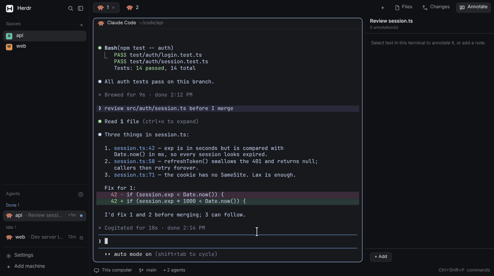

# Herdr Easy Annotate

[](LICENSE)


<p align="center">
  <a href="#install">install</a> · <a href="#quick-start">quick start</a> · <a href="#keys">keys</a> ·
  <a href="#update-and-uninstall">update</a> · <a href="#limitations">limitations</a> ·
  <a href="#acknowledgements">acknowledgements</a>
</p>

Review your agent's output the way you'd review a pull request. Select any text in a
[Herdr](https://herdr.dev) terminal, mark it **looks good**, **comment** on it or flag it for
**delete**, and send all of your notes to the agent in one message.



<sub>A recreation of the UI with sample content (`docs/demo/`), not a screen recording.</sub>

> [!TIP]
> Using the **herdr TUI** rather than the desktop app? Use
> [plannotator/herdr-annotate](https://github.com/plannotator/herdr-annotate), which this mod is modelled on.

## Install

**Easiest, on any OS:** paste this into an agent running in Herdr:

```text
Read ~/.config/herdr-app/AGENTS.md, then add this mod: github.com/chandrasekharan98/herdr-ez-annotate
```

**Or run the installer** with the Herdr app open. It needs Python 3 and nothing else.

macOS and Linux:

```sh
curl -fsSL https://raw.githubusercontent.com/chandrasekharan98/herdr-ez-annotate/main/install.py | python3 -
```

Windows (PowerShell):

```powershell
irm https://raw.githubusercontent.com/chandrasekharan98/herdr-ez-annotate/main/install.py | py -
```

From a clone, run `python3 install.py`.

The installer:

1. Copies the mod to `~/.config/herdr-app/mods/ez-annotate/`.
2. Adds an **Annotate** button beside Files and Changes in the top bar. Herdr's top bar can't be
   extended yet, so it makes a copy of the built-in `tabs` mod (`tabs-annotate`) and an
   `annotate` layout that uses it. Your `main` layout and the built-in `tabs` mod aren't touched.
3. Binds `ctrl-shift-a` and `cmd-shift-a` to the selection key, unless you already use them.
4. Switches to the `annotate` layout.

## Requirements

| | Linux | macOS | Windows |
| --- | --- | --- | --- |
| Herdr app | 0.1.15 or later | 0.1.15 or later | 0.1.15 or later |
| Popup on select | Yes. Needs `wl-clipboard` (Wayland) or `xclip` (X11) | No, press the key | No, press the key |
| Tested | Yes (Hyprland) | Not yet | Not yet |

Python 3 is only needed by `install.py`, not by the mod.

## Quick start

1. Click **Annotate** in the top bar. The side panel lists the focused pane's annotations and
   follows focus as you move between panes.
2. Select text in a terminal. On Linux a small bar opens at the pointer by itself. On macOS and
   Windows, press `cmd-shift-a` (macOS) or `ctrl-shift-a`.
3. Press `a` for **looks good**, `d` for **delete**, or `c` to **comment**. In a comment, Enter
   saves and Shift+Enter starts a new line.
4. Click a card to edit it, or click `✕` on the selected card to delete it. **+ Add** writes a
   note without a quote.
5. Click **Send to agent** to type every note into the pane's agent and press Enter, or **Copy all**
   to paste them yourself. The notes then leave the list. **Undo** brings them back.

What the agent receives:

```
Notes on your terminal output:

> first line of the quote
> …
> last line of the quote
Rename this to fooBar

> npm test passed
✓ looks good

> rm -rf build
✗ remove/undo this
```

## Keys

| Key | What it does |
| --- | --- |
| `ctrl-shift-a` / `cmd-shift-a` | Annotate the focused terminal's selection |
| `a` / `c` / `d` (in the bar) | Looks good / comment / delete |
| Enter / Shift+Enter (in a comment) | Save / new line |
| Esc | Close the bar, or cancel an edit |

To toggle the side-panel sections from the keyboard, add any of these to the `global` section
of `~/.config/herdr-app/keys.json`:

```json
"ctrl-b a": "tabs-annotate.annotate",
"ctrl-b f": "tabs-annotate.files",
"ctrl-b g": "tabs-annotate.changes"
```

## Update and uninstall

- **Update:** run the installer again, or ask your Herdr agent to update the mod. This also
  refreshes `tabs-annotate` from your current Herdr, so top-bar changes in Herdr updates are kept.
- **Uninstall:** `python3 install.py --uninstall` (on Windows, run it with `py`). It removes the
  mod, `tabs-annotate`, the keys and the `annotate` layout, and switches back to `main`. Your
  annotations stay in `~/.config/herdr-app/state/ez-annotate/`.

## Limitations

- **No selection API yet.** On Linux the panel checks the primary selection every 250 ms, so
  the bar opens 250–500 ms after you release the mouse. It opens where the pointer is, which is
  where the drag ended unless you moved the mouse.
- **The key uses the clipboard on macOS and Windows.** It copies the selection, reads it, then
  puts your clipboard back. Only text is restored: an image on the clipboard is lost.
- **The popup only works while the Annotate section is open.** The panel is what watches for
  selections. The key works whenever the `annotate` layout is showing.
- **Send refuses panes that aren't agents.** It presses Enter, and a shell would run the text.
- **The top-bar button needs a forked `tabs` mod.** Herdr updates to `tabs` reach the fork only
  when you run the installer again.

## Pairs well with

- [herdr-workspace-save](https://github.com/chandrasekharan98/herdr-workspace-save): save a
  workspace's layout, folders and agent sessions, and reopen it later. Its space menu can share
  the `annotate` layout; see "Optional: space menu" in its `app/RECIPE.md`.

## Where annotations live

`~/.config/herdr-app/state/ez-annotate/annotations.jsonl` holds one annotation per line, and
`archives.jsonl` holds one copied or sent set per line. They use the same format as
plannotator's TUI plugin, plus `terminal_id` and `kind` (`ok` or `delete`; absent for a comment):

```json
{"selectedText":"…","capturedAt":"ISO","context":{"workspace_id":"…","workspace_label":"…","tab_id":"…","tab_label":"…","focused_pane_id":"…","focused_pane_cwd":"…","focused_pane_agent":"…","terminal_id":"t7"},"id":"uuid","comment":"…","createdAt":"ISO","kind":"ok"}
{"version":1,"id":"uuid","archivedAt":"ISO","annotations":[ … ]}
```

## Acknowledgements

The select-then-comment flow, the "looks good / comment / delete" choices and the annotation
format come from [herdr-annotate](https://github.com/plannotator/herdr-annotate), the herdr TUI
plugin by [Plannotator](https://github.com/backnotprop/plannotator) (MIT). Herdr Easy Annotate brings
that flow to the Herdr desktop app as a native mod. It shares no code with the plugin. If you
like this, star [Plannotator](https://github.com/backnotprop/plannotator).

## Development

- `node test/lib.test.js` tests the formatter and the JSONL store.
- `herdr-app check mods/ez-annotate` checks the mod.
- `node docs/demo/render.mjs` re-renders `docs/demo.gif` and `preview.png`. It needs Chromium
  and ffmpeg.
- [RECIPE.md](RECIPE.md) describes the mod for an agent rebuilding or adapting it.

## License

[MIT](LICENSE)
