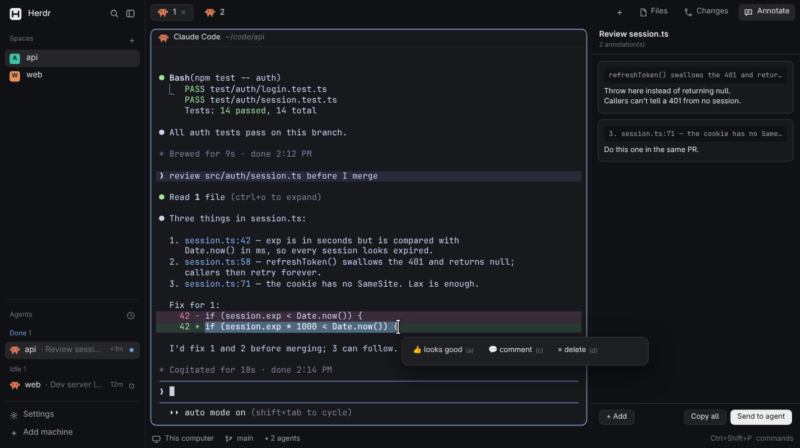

# Herdr Easy Annotate

Select text in any terminal and a small bar pops up at the pointer: looks good, comment or
delete. A sidebar on the right lists the focused pane's annotations as cards you can edit and
delete, and sends them to that pane's coding agent as one compact message (or copies them).

<!-- preview.png is an HTML recreation with sample content (docs/demo/), not a screenshot of a real window. -->

## What you see

- **Popup** (420x46, Herdr's popup frame, `popover`): one row, 12.5px, three 30px items,
  `👍 looks good (a)`, `💬 comment (c)`, `✕ delete (d)`, the key hint in `dim` at 11px, `hover`
  on hover. Comment mode is a 420x170 popup: a growing comment box (1 to 6 rows,
  10px/8px padding, `accent` border, `background`), the hint "Enter save · Shift+Enter new line ·
  Esc cancel" in `dim` 10.5px, and a Save button (`solid`) at the right.
- **Annotate section** in the side panel beside Files and Changes (a child of the `panel-body`
  stack in a clone of `main`), opened by an "Annotate" button in the top bar.
  - Header, 40px, bottom `border`: the pane's title (13px semibold, truncated) over
    "n annotation(s)" (10.5px `dim`).
  - Cards (`surface`, `border`, radius 8, 8px padding, gap 8, scrolls): an optional tag
    ("✓ looks good" on `done`, "✗ remove/undo this" on `blocked`, 10.5px semibold), the quote
    in the terminal font at 11.5px `muted` on `background` (first and last line with "…"
    between when longer than two lines, each truncated), then the comment at 12.5px. Hover
    borders in `accent`. The selected card is `selected` with an `accent` border, a 20px `✕`
    top right, and its comment as an input with a Save button.
  - Empty: "Select text in this terminal to annotate it, or add a note.".
  - Footer, top `border`: "+ Add" left; "Copy all" and "Send to agent" (`solid`) right, only
    when there are annotations. 26px buttons, radius 7.

## How it behaves

- On Linux, selecting text in a terminal (Herdr copies selections to PRIMARY) opens the popup once the
  selection holds still. `a` / click saves a "looks good" annotation, `d` a "delete" one, `c`
  swaps the bar for a 420x170 popup with a comment box (Enter saves a non-empty one,
  Shift+Enter adds a line). Esc or a click elsewhere closes it. Every
  annotation stores the quote and the terminal.
- The `selection` command (`ez-annotate.selection`, `ctrl-shift-a` / `cmd-shift-a`) opens the
  same popup on every platform: it writes a sentinel to the clipboard, runs `terminal.copy`,
  waits up to 500 ms for the clipboard to change, then restores the old text.
- No popup when the Annotate section is closed or not the shown section, the window isn't active, no terminal has focus, the
  selection is blank or unchanged, or the comment box is open. A new selection while the bar
  is open replaces the bar; one made while the section was shut pops when it opens. Coming
  back to the window or closing the comment box takes the current selection as already seen.
- The list follows `focused().terminal` live; clicking the panel itself keeps the last pane.
- Click a card: select and edit; Enter or Save stores the comment, Esc cancels. `✕` deletes at
  once. "+ Add": an input card on top; Enter stores a note with no quote (empty: nothing).
- Copy all: the block below on the clipboard. Send to agent: refused with a toast unless the
  pane is an agent; `hc send <terminal> <block>`; on failure they stay and the error is toasted.
  After either, the pane's annotations move to one archive set, and a bar above the footer
  ("n copied" / "n sent to agent", `dim`, with an Undo button) moves that set back.
- Output, in herdr-annotate's feedback shape so the agent reads it as annotations:
  `# Annotations on terminal selections (<space> / <tab>)`, then per annotation (oldest
  first, blank line between) `## Annotation N`, `Comment on: "<quote>"` (a quote spanning
  lines is fenced, longer than any backtick run in it; quotes over two lines keep first, `…`,
  last), then `✓ looks good` / `✗ remove/undo this` and the comment as `> ` lines.
- While a copy or send runs, Copy all and Send to agent are replaced by "Copying…" /
  "Sending…" and extra clicks are ignored, so one click sends once.
- Agent status isn't shown.

## Built from

- Install: run `python3 install.py` from this repository (`--uninstall` removes it). It copies `mods/ez-annotate`, re-forks the built-in `tabs` as `tabs-annotate` with an Annotate button, writes `layouts/annotate.json` and adds `keys.json`'s keys where free. If the `tabs` patch fails, apply the same edits by hand as described below.
- One mod, `mods/ez-annotate/` (`main.js`, pure `lib.js`), `mod.json`
  `{"place":"none","title":"Herdr Easy Annotate"}`. Roles by `props().role`: none = the panel,
  `popup` = the bar, opened by the panel with `openOverlay({mod, kind:"popup", at:"pointer",
  width:420, height:46, props:{role:"popup", quote, terminal}})`.
- Layout: a copy of `main.json` with `{"id":"annotate","type":"block","content":{"mod":"ez-annotate"}}`
  appended to `panel-body`'s children, and its `tabs` block using `tabs-annotate`, a copy of the
  built-in `tabs` mod with an Annotate button (see install.py, `patch_tabs`).
- Panel loop: `cx.spawn` + `cx.timer.after(250)`; `window().active`, `focused()`,
  `wl-paste --primary` or `xclip -o -selection primary`, Linux only (`window().platform`). Shared keys: `ez-annotate.rev` (the popup bumps it after a save; the panel reloads),
  `ez-annotate.popup` (open time, passed to the popup as `opened`, so the panel tells its bar from
  the comment box; the popup's `close()` clears it, ignored after 5 min).
- `panes()` for the title and context, `agents()` for the send check, `hc send`, `cx.write_to_clipboard`. Store: `fs/promises` under
  `~/.config/herdr-app/state/ez-annotate/`, TUI JSONL schema plus `context.terminal_id`
  and `kind`.

## Watch out

- Never use a hidden or 1x1 kept window for background work: it ate every mouse click in
  v1. The watcher lives in the visible panel.
- The popup can't follow the selection, only the pointer, and opens 250–500 ms after release.
- The comment box's input can set PRIMARY itself; the panel doesn't poll while it is open.
- Don't re-read the baseline when the bar closes: a click beside it that starts the next drag
  would make that selection the baseline, and it would never pop.
- `hc send` presses Enter; to a shell that would run `> comment` as a redirect. Keep the agent
  check.
- Don't write the store under `mods/`: saving there reloads the mod.

## Done when

- `herdr-app check mods/ez-annotate` passes and `node test/lib.test.js` prints `ok`.
- With the `annotate` layout shown, dragging over text in a terminal opens the bar; `a` adds a
  "✓ looks good" card for that pane and a line in `annotations.jsonl`.
- Switching panes switches the list; Send to agent in a Claude Code pane submits the block and
  empties the list.
